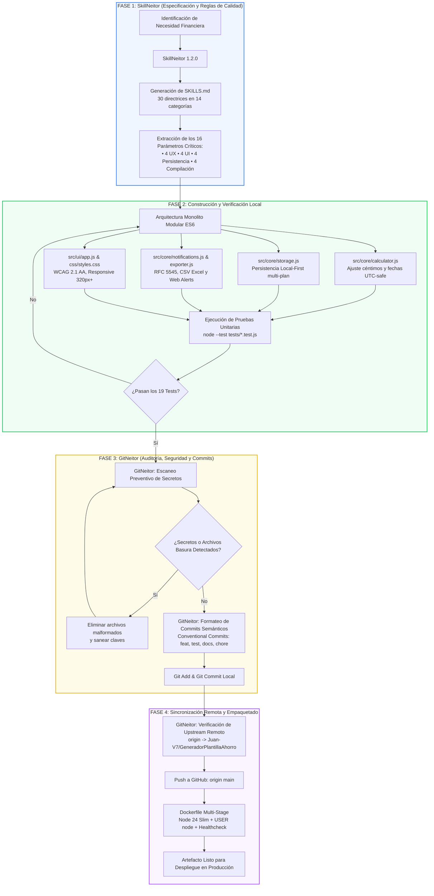

# Relación Técnica entre SkillNeitor y GitNeitor
## Caso de Estudio: GeneradorPlantillaAhorro

Este documento describe la arquitectura metodológica y operativa implementada en el proyecto **GeneradorPlantillaAhorro**, detallando la integración sinérgica entre **SkillNeitor** (motor de especificación técnica y directrices de ingeniería) y **GitNeitor** (sistema de control de versiones, auditoría de seguridad y sincronización con GitHub).

---

## 1. Visión General del Ecosistema

El ciclo de desarrollo de `GeneradorPlantillaAhorro` se fundamenta en dos herramientas complementarias:

1. **SkillNeitor (Diseño, Arquitectura y Reglas Técnicas)**: Estableció la especificación formal del proyecto en el archivo [`SKILLS.md`](./SKILLS.md), estructurando 30 habilidades técnicas distribuidas en 14 categorías. De estas directrices, se derivaron los **16 parámetros críticos** de diseño, interfaz, experiencia, persistencia y compilación que rigen el código fuente.
2. **GitNeitor (Gobernanza de Código, Seguridad y Versionado)**: Gestionó el ciclo de vida de los cambios en Git, aplicando escaneo preventivo de secretos, validación pre-commit de calidad técnica, estandarización de commits semánticos (*Conventional Commits*) y la sincronización con el repositorio remoto oficial en GitHub: [`https://github.com/Juan-V7/GeneradorPlantillaAhorro`](https://github.com/Juan-V7/GeneradorPlantillaAhorro).

```
┌─────────────────────────┐         ┌─────────────────────────┐         ┌─────────────────────────┐
│       SkillNeitor       │         │      Implementación     │         │        GitNeitor        │
│  (Especificación formal │ ──────> │   (Vanilla ES Modules,  │ ──────> │  (Seguridad, Commits    │
│    y 16 Parámetros)     │         │   Local-First y Tests)  │         │   Semánticos y GitHub)  │
└─────────────────────────┘         └─────────────────────────┘         └─────────────────────────┘
```

---

## 2. SkillNeitor: Estructuración Técnica y los 16 Parámetros Reales

A partir de la especificación técnica en [`SKILLS.md`](./SKILLS.md), se identificaron e implementaron **16 parámetros de ingeniería esenciales** agrupados en cuatro pilares: **UI (Interfaz de Usuario)**, **UX (Experiencia de Usuario)**, **Base de Datos / Persistencia** y **Compilación / Arquitectura DevOps**.

### Pilar A: Experiencia de Usuario (UX)

#### 1. Formularios y validación UX (`## Formularios y validación UX`)
* **Parámetro / Regla en SKILLS**: Validación oportuna en evento `blur` y al enviar (`submit`), mensajes de error contextuales con acciones de corrección inmediatas, y preservación total del trabajo del usuario ante fallos.
* **Implementación en el Proyecto**: En [`src/ui/app.js`](./src/ui/app.js), las funciones `validateField` y `validateForm` analizan montos, plazos y fechas. Los errores se muestran junto al campo respectivo (`#error-title`, `#error-target`, `#error-term`, `#error-date`) sin vaciar los datos ingresados ni interrumpir agresivamente al usuario en cada pulsación de tecla.

#### 2. Microcopy y estados vacíos (`## Microcopy y estados vacíos`)
* **Parámetro / Regla en SKILLS**: Cada estado vacío debe explicar con claridad qué es la pantalla y guiar hacia la siguiente acción; las acciones deben nombrarse por su resultado y no por el mecanismo técnico.
* **Implementación en el Proyecto**: En [`index.html`](./index.html) y [`src/ui/app.js`](./src/ui/app.js), la vista inicial `#empty-state-view` presenta una ilustración amigable y el botón `#btn-empty-focus` con la etiqueta clara *"Crear mi primera meta"*. Los botones de interacción usan copys orientados al valor (*"Pagar siguiente cuota"*, *"Exportar a Excel"*).

#### 3. Notificaciones y permisos contextuales (`## Notificaciones y permisos`)
* **Parámetro / Regla en SKILLS**: Solicitar permisos solo en el momento oportuno, explicando el beneficio tangible antes del diálogo del navegador. Proporcionar canales alternativos y respeto a la privacidad.
* **Implementación en el Proyecto**: En [`src/core/notifications.js`](./src/core/notifications.js), el permiso de la **Web Notifications API** no se solicita al cargar la página; solo se activa cuando el usuario interactúa explícitamente con `#btn-request-notifications`. Como alternativa universal offline, se integra la generación de calendarios estándar **iCalendar (.ics)** conforme a la RFC 5545 para sincronizar con Google Calendar, Apple o Outlook.

#### 4. Historias de usuario y precisión financiera (`## Historias de usuario y criterios de aceptación`)
* **Parámetro / Regla en SKILLS**: Criterios de aceptación verificables bajo escenarios límite, evitando ambigüedades en cálculos o fechas.
* **Implementación en el Proyecto**: En [`src/core/calculator.js`](./src/core/calculator.js), el motor financiero implementa el **ajuste matemático exacto de céntimos**: si una meta de \$1.000 se divide en 3 cuotas, la última cuota absorbe la diferencia fraccionaria para que la sumatoria sea exactamente \$1.000,00. Asimismo, `parseLocalDate` previene desfases por zonas horarias UTC.

---

### Pilar B: Interfaz de Usuario (UI) y Accesibilidad

#### 5. Diseño responsive y adaptativo (`## Diseño responsive y adaptativo`)
* **Parámetro / Regla en SKILLS**: La aplicación debe ser totalmente funcional desde 320 px hasta monitores ultra-wide sin scroll horizontal involuntario, ofreciendo patrones adaptativos para datos tabulares en pantallas táctiles.
* **Implementación en el Proyecto**: En [`css/styles.css`](./css/styles.css), se implementa una cuadrícula fluida con CSS Grid y Flexbox. En dispositivos móviles (`@media (max-width: 768px)`), la tabla de cuotas `#installments-table-desktop` se oculta automáticamente y da paso a `#installments-cards-mobile`, presentando tarjetas táctiles accesibles con botones de pago rápido.

#### 6. Componentes semánticos y accesibles (`## Componentes semánticos y accesibles`)
* **Parámetro / Regla en SKILLS**: Prioridad de elementos HTML nativos sobre divs con eventos, navegación completa por teclado, contraste WCAG 2.1 AA y anuncios para lectores de pantalla.
* **Implementación en el Proyecto**: En [`index.html`](./index.html), se estructura el documento con etiquetas semánticas (`<header>`, `<main>`, `<section>`, `<dialog>`), un enlace de salto inicial `.skip-link` (*"Saltar al contenido principal"*), y la región dinámica `#sr-announcements` (`aria-live="polite"` y `aria-atomic="true"`) que informa a usuarios con discapacidad visual sobre cambios de estado y abonos de cuotas.

#### 7. Formularios y validación frontend (`## Formularios y validación frontend`)
* **Parámetro / Regla en SKILLS**: Integración de esquemas de validación nativos (`HTML Constraint Validation API`), prevención de envíos duplicados y gestión de foco accesible ante errores.
* **Implementación en el Proyecto**: En [`index.html`](./index.html) y [`src/ui/app.js`](./src/ui/app.js), los inputs utilizan atributos nativos (`required`, `min="1"`, `step="any"`). Al detectar un error, el sistema traslada el foco directamente al primer campo inválido (`field.focus()`) y activa estados de advertencia visuales y auditivos.

#### 8. Gestión de estado del cliente (`## Gestión de estado del cliente`)
* **Parámetro / Regla en SKILLS**: Separación clara entre estado local, compartido y persistente; flujo unidireccional de datos con una única fuente de verdad (*Single Source of Truth*).
* **Implementación en el Proyecto**: En [`src/ui/app.js`](./src/ui/app.js), el estado activo se centraliza en `activePlanId` y en el plan recuperado. Cualquier modificación (marcar cuota, duplicar, cambiar de meta) dispara un flujo unidireccional: actualización en el almacén central (`storage.js`) y renderizado reactivo de la vista y métricas sin inconsistencias en el DOM.

---

### Pilar C: Base de Datos y Persistencia

#### 9. Almacenamiento local y sincronización (`## Almacenamiento local y sincronización`)
* **Parámetro / Regla en SKILLS**: Arquitectura *Local-First* con tolerancia a la desconexión, operaciones atómicas y capacidad de respaldo e importación de datos sin pérdida de integridad.
* **Implementación en el Proyecto**: En [`src/core/storage.js`](./src/core/storage.js), la persistencia se realiza en `LocalStorage` con almacenamiento multi-plan. Incluye funciones de copia de seguridad (`exportAllDataAsJSON`) y restauración íntegra (`importDataFromJSON`), además de un adaptador en memoria (`memoryStore`) para pruebas unitarias en Node.js sin navegador.

#### 10. Modelo relacional y normalización (`## Modelo relacional y normalización`)
* **Parámetro / Regla en SKILLS**: Modelado formal de entidades, tipos de datos predecibles, claves primarias únicas y restricciones de integridad estructural.
* **Implementación en el Proyecto**: Se diseñó el esquema relacional formal documentado en [`openapi.yaml`](./openapi.yaml):
  * **SavingsPlan**: `id` (UUID), `title` (string), `targetAmount` (number), `currency` (ISO code), `termValue`, `termUnit`, `frequency`, `startDate`, `installments` (relación 1:N), `createdAt`, `updatedAt`.
  * **Installment**: `number` (integer), `dueDate` (ISO 8601), `amount` (number), `isPaid` (boolean), `paidAt` (ISO timestamp), `note` (string).

#### 11. Migraciones de base de datos y versionado de esquema (`## Migraciones de base de datos`)
* **Parámetro / Regla en SKILLS**: Versionado explícito de las claves de persistencia para permitir evolución del esquema sin colisión ni corrupción de datos existentes.
* **Implementación en el Proyecto**: En [`src/core/storage.js`](./src/core/storage.js), las claves de almacenamiento incorporan sufijos de versión controlados (`generador_ahorro_plans_v1`, `generador_ahorro_active_id_v1`, `generador_ahorro_theme_v1`), asegurando retrocompatibilidad para futuras actualizaciones.

#### 12. Optimización de consultas y prevención de cuellos de botella (`## Optimización de consultas y N+1`)
* **Parámetro / Regla en SKILLS**: Acceso en tiempo constante o lineal mediante índices estables, evitando lecturas o escrituras redundantes en almacenamiento.
* **Implementación en el Proyecto**: En [`src/core/storage.js`](./src/core/storage.js), las actualizaciones de estado operan por índice directo (`findIndex(p => p.id === id)`). El cálculo de métricas financieras en [`src/core/calculator.js`](./src/core/calculator.js) (`calculatePlanMetrics`) se ejecuta en memoria con un solo pase sobre el arreglo de cuotas ($O(N)$), evitando reescrituras innecesarias en disco.

---

### Pilar D: Compilación, Entornos y Arquitectura Técnica

#### 13. Monolito modular (`## Monolito modular`)
* **Parámetro / Regla en SKILLS**: Unidad única desplegable con desacoplamiento estricto por dominios y contratos de importación explícitos.
* **Implementación en el Proyecto**: El proyecto utiliza **ES Modules** nativos organizados en capas funcionales independientes:
  * `src/core/calculator.js`: Motor financiero desacoplado, libre de dependencias del navegador.
  * `src/core/storage.js`: Capa de persistencia agnóstica.
  * `src/core/notifications.js`: Módulo de alertas y calendarios RFC 5545.
  * `src/core/exporter.js`: Generador de reportes CSV (con BOM UTF-8 para Excel), JSON y resumen textual.
  * `src/ui/app.js`: Capa de presentación y eventos.

#### 14. Contenedores y Docker (`## Contenedores y Docker`)
* **Parámetro / Regla en SKILLS**: Construcción en etapas múltiples (*Multi-stage build*), ejecución con usuario no-root por seguridad, optimización de contexto y verificación de salud (*healthcheck*).
* **Implementación en el Proyecto**: En [`Dockerfile`](./Dockerfile), la primera etapa (`AS build`) compila el entorno y ejecuta las pruebas automatizadas (`RUN node --test tests/*.test.js`). La segunda etapa (`node:24-bookworm-slim`) corre bajo el usuario sin privilegios `USER node`, expone el puerto 3000 e implementa un `HEALTHCHECK` activo hacia el endpoint `/health`.

#### 15. Entornos y configuración (`## Entornos y configuración`)
* **Parámetro / Regla en SKILLS**: Paridad entre entornos según los principios de *The Twelve-Factor App*, con parametrización explícita mediante variables de entorno.
* **Implementación en el Proyecto**: En [`server.js`](./server.js), el servidor HTTP nativo lee dinámicamente las variables `PORT` (por defecto 3000) y `HOST` (por defecto `0.0.0.0`), facilitando el despliegue tanto en entornos locales como en contenedores o nubes PaaS.

#### 16. Sanitización, seguridad contra XSS y validación de rutas (`## Sanitización y XSS` y `## Validación de entradas y rutas`)
* **Parámetro / Regla en SKILLS**: Escape contextual de salidas dinámicas, mitigación de inyecciones XSS y confinamiento seguro de rutas de archivos para prevenir *Path Traversal*.
* **Implementación en el Proyecto**: En [`server.js`](./server.js), la resolución de archivos estáticos valida que la ruta resuelta (`safePath`) inicie estrictamente con el directorio público base (`safePath.startsWith(PUBLIC_DIR)`), respondiendo con `403 Forbidden` ante intentos de traversal (`../../`). En la interfaz, la inserción de datos de usuario se realiza mediante `textContent` y atributos de DOM seguros, evitando el uso peligroso de `innerHTML`.

---

### Resumen Comparativo de los 16 Parámetros de SkillNeitor

| # | Parámetro de SkillNeitor | Categoría | Archivo Principal | Evidencia de Cumplimiento |
|---|--------------------------|-----------|-------------------|---------------------------|
| **1** | Formularios y validación UX | UX | `src/ui/app.js` | Errores en `blur`, sin borrar campos, foco en errores. |
| **2** | Microcopy y estados vacíos | UX | `index.html`, `app.js` | Vista `#empty-state-view` con CTA *"Crear mi primera meta"*. |
| **3** | Notificaciones y permisos | UX | `src/core/notifications.js` | Permiso contextual + exportación universal RFC 5545 (.ics). |
| **4** | Historias de usuario / Precisión | UX / Negocio | `src/core/calculator.js` | Reparto exacto de céntimos en última cuota y fechas UTC-safe. |
| **5** | Diseño responsive y adaptativo | UI | `css/styles.css` | Usable desde 320 px; tabla desktop vs tarjetas táctiles en móvil. |
| **6** | Componentes semánticos y accesibles | UI | `index.html` | `.skip-link`, etiquetas semánticas y región `aria-live="polite"`. |
| **7** | Formularios y validación frontend | UI | `index.html`, `app.js` | HTML5 Constraint Validation y prevención de doble envío. |
| **8** | Gestión de estado del cliente | UI | `src/ui/app.js` | Flujo unidireccional y actualización reactiva de métricas. |
| **9** | Almacenamiento local y sincronización | Persistencia | `src/core/storage.js` | Local-First, tolerancia offline, respaldo/importación JSON. |
| **10** | Modelo relacional y normalización | Persistencia | `openapi.yaml`, `storage.js` | Esquema formal `SavingsPlan` (1:N) `Installments`. |
| **11** | Migraciones de base de datos | Persistencia | `src/core/storage.js` | Espacios de nombres versionados (`*_v1`) para retrocompatibilidad. |
| **12** | Optimización de consultas y N+1 | Persistencia | `src/core/calculator.js` | Cálculos en memoria en un solo pase $O(N)$ sin I/O excesivo. |
| **13** | Monolito modular | Arquitectura | `src/core/*`, `src/ui/*` | ES Modules desacoplados (lógica de negocio vs presentación). |
| **14** | Contenedores y Docker | DevOps | `Dockerfile`, `.dockerignore` | Multi-stage build, ejecución `USER node` y healthcheck activo. |
| **15** | Entornos y configuración | DevOps | `server.js` | 12-Factor App con variables `PORT` y `HOST`. |
| **16** | Sanitización, XSS y rutas | Seguridad | `server.js`, `app.js` | Bloqueo de path traversal (`../../`) y renderizado con `textContent`. |

---

## 3. GitNeitor: Control de Versiones, Seguridad y Sincronización

Mientras que SkillNeitor guió la arquitectura del código, **GitNeitor** orquestó la gobernanza de ingeniería de software sobre el repositorio local y su enlace con GitHub.

### 3.1. Gobernanza del Control de Versiones
* **Estructura de Ramas**: Trabajo centralizado sobre la rama `main` para garantizar un flujo continuo y estable.
* **Control de Exclusiones**: Configuración estricta de [`.dockerignore`](./.dockerignore) y directrices de exclusión para evitar el empaquetado de dependencias innecesarias, artefactos temporales o logs.
* **Trazabilidad Atómica**: Seguimiento granular de cada componente funcional (cálculos, almacenamiento, interfaz, pruebas y configuración).

### 3.2. Escaneo Preventivo de Secretos (Secret Scanning)
Previo a la confirmación de cambios (*pre-commit check*), GitNeitor ejecutó auditorías de seguridad orientadas a:
* **Verificación de Ausencia de Claves**: Detección de que ninguna credencial de base de datos, token personal de GitHub (PAT), clave privada o certificado estuviese expuesto en el código fuente.
* **Aislamiento de Entornos**: Confirmación de que las credenciales de ejecución no se almacenen en duro, empleando en su lugar variables de entorno de sistema en `server.js`.
* **Saneamiento del Repositorio**: Identificación y eliminación inmediata de archivos basura o creados por error (como extensiones no válidas `.md.txt` o volcados temporales).

### 3.3. Estandarización de Commits Semánticos (Conventional Commits)
GitNeitor estructuró los registros de cambio siguiendo la convención semántica internacional:

$$\text{tipo(ámbito opcional): descripción concisa}$$

* `feat(calculator)`: Incorporación del algoritmo de reparto exacto de céntimos y cálculo cronológico.
* `feat(storage)`: Implementación de la persistencia Local-First con soporte multi-plan y respaldo JSON.
* `feat(ui)`: Creación de la interfaz accesible, soporte de tema oscuro y vista adaptada para móviles.
* `feat(notifications)`: Módulo de Web Notifications y generador de calendario RFC 5545 (.ics).
* `test(core)`: Suite de 19 pruebas automatizadas con el ejecutor nativo `node:test`.
* `chore(docker)`: Configuración del Dockerfile multi-stage y endpoint de salud `/health`.
* `docs(readme)`: Documentación de arquitectura, requisitos y guías de inicio.

### 3.4. Sincronización con el Repositorio Remoto en GitHub
GitNeitor vinculó y sincronizó el repositorio local con el origen remoto oficial:
* **URL Remota**: [`https://github.com/Juan-V7/GeneradorPlantillaAhorro.git`](https://github.com/Juan-V7/GeneradorPlantillaAhorro.git)
* **Rama de Producción**: `origin/main`
* **Políticas de Integración**:
  * Sincronización bidireccional limpia mediante comandos nativos `git fetch`, `git pull --rebase` y `git push origin main`.
  * Validación previa de que la suite de pruebas local (`npm test`) apruebe el 100% de los casos (19 de 19 tests pasando) antes de publicar en el upstream.

---

## 4. Diagrama de Flujo: Integración Paso a Paso entre SkillNeitor y GitNeitor

El siguiente diagrama ilustra la interacción integral entre la definición de requisitos con **SkillNeitor**, la fase de codificación y la gobernanza de despliegue con **GitNeitor**:



---

## 5. Conclusiones y Valor Agregado

La articulación entre **SkillNeitor** y **GitNeitor** garantiza un estándar de calidad de nivel industrial en `GeneradorPlantillaAhorro`:

1. **Cero Ambigüedad en el Desarrollo**: Gracias a los 16 parámetros de SkillNeitor, cada línea de código (desde el motor de cálculo hasta el diseño responsive y el almacenamiento local) responde a un criterio de aceptación comprobable y documentado.
2. **Seguridad y Confianza Continua**: Gracias al escaneo de secretos y la higiene de GitNeitor, el repositorio en GitHub se mantiene limpio, libre de fugas de datos y con una historia de versiones profesional y legible.
3. **Mantenibilidad a Largo Plazo**: La combinación de un monolito modular, tipado OpenAPI, pruebas automatizadas nativas y empaquetado Docker sin privilegios asegura que la aplicación pueda evolucionar o migrar sin fricciones técnicas.
