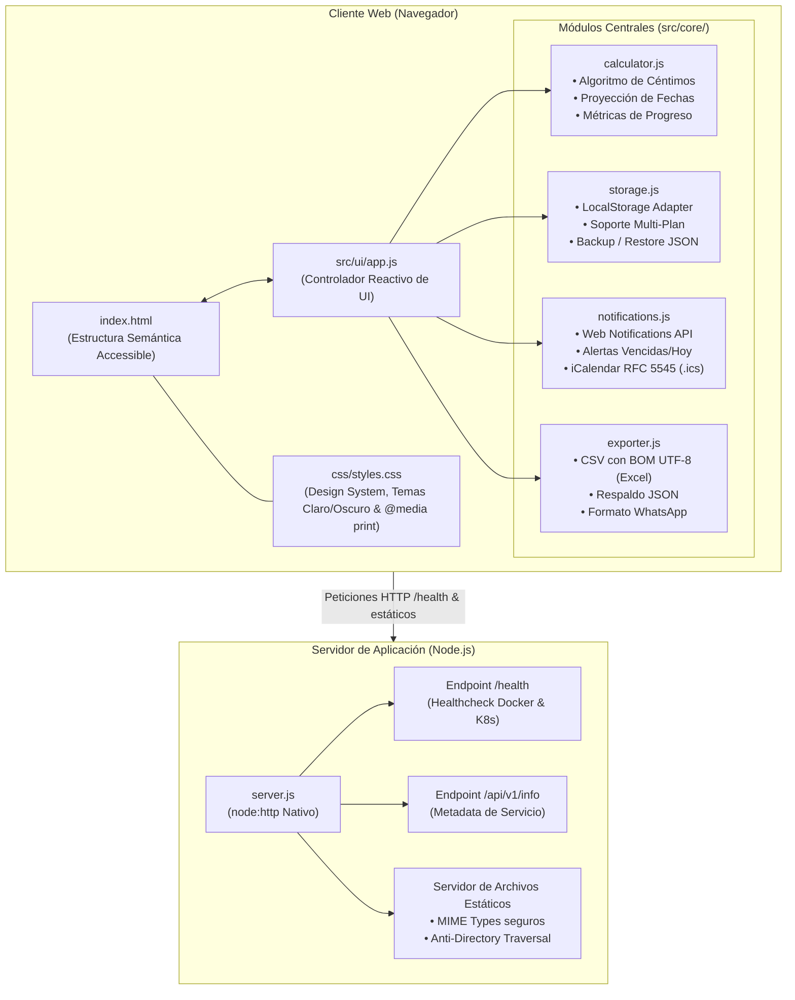

# Manual Técnico del Sistema
# GeneradorPlantillaAhorro 💰🌱

> **Versión del Sistema:** 1.0.0  
> **Fecha de Actualización:** Noviembre 2026  
> **Licencia:** MIT  
> **Repositorio Oficial:** [Juan-V7/GeneradorPlantillaAhorro](https://github.com/Juan-V7/GeneradorPlantillaAhorro)

---

## 1. Identificación y Objetivos del Sistema

**GeneradorPlantillaAhorro** es una aplicación web integral, modular y *Local-First* diseñada para la planificación, cálculo y control cronológico de metas de ahorro programado a medida. El sistema opera prioritariamente en **Pesos Colombianos (COP)** y proporciona algoritmos financieros deterministas para el desglose exacto de cuotas periódicas (**semanales**, **quincenales** o **mensuales**), garantizando una conciliación del 100% de los céntimos en la última cuota y eliminando desajustes de fechas por conversión de zonas horarias.

### Principios Fundamentales de Ingeniería
* **Arquitectura Local-First:** Todos los datos del usuario se almacenan y procesan de forma privada en el almacenamiento local del navegador (`LocalStorage`), permitiendo su funcionamiento 100% *offline*.
* **Cero Dependencias Externas en Producción (*Zero-Dependency Backend*):** El servidor HTTP está construido exclusivamente con los módulos nativos de Node.js (`node:http`, `node:fs`, `node:path`, `node:url`), garantizando mínima superficie de ataque, arranque instantáneo y portabilidad absoluta.
* **Modularidad Estricta en ES6 Modules:** Separación clara entre el núcleo de cómputo financiero (`src/core/`) y la capa de presentación y eventos (`src/ui/`).
* **Accesibilidad Universal y Diseño Inclusivo (WCAG 2.1 Nivel AA):** Interfaz compatible con navegación por teclado, anuncios dinámicos para lectores de pantalla (`aria-live="polite"`), alto contraste y adaptación táctil fluida para dispositivos móviles a partir de 320 px.
* **Contratos Formales OpenAPI 3.1.0:** Estructuración tipada de modelos de datos (`SavingsPlan`, `Installment`, `PlanMetrics`) y endpoints de verificación.

---

## 2. Arquitectura General del Sistema

El sistema implementa una variante moderna del patrón **Monolito Modular Desacoplado**, complementado con persistencia reactiva en cliente.



### Capas del Sistema

1. **Capa de Presentación (`index.html` + `css/styles.css`):**
   - Estructuración semántica con etiquetas nativas (`<header>`, `<main>`, `<aside>`, `<section>`, `<dialog>`, `<table>`).
   - Hoja de estilos basada en variables CSS (`:root` y `[data-theme="dark"]`).
   - Adaptabilidad responsive: la tabla de escritorio se transforma en tarjetas táctiles en dispositivos móviles (`@media (max-width: 768px)`).
   - Hoja de estilos especializada `@media print` para exportación ejecutiva en PDF.

2. **Capa de Control e Interacción (`src/ui/app.js`):**
   - Orquesta la reactividad de la vista y la interacción del usuario sin librerías pesadas.
   - Validación reactiva de campos de formulario mediante la `HTML Constraint Validation API` y eventos `blur`.
   - Región dinámica accesible `#sr-announcements` (`aria-live="polite"`) para retroalimentación auditiva a lectores de pantalla.

3. **Capa de Lógica Financiera (`src/core/calculator.js`):**
   - Módulo puramente funcional, sin estado y desacoplado del DOM.
   - Determina el número exacto de cuotas según el plazo (meses o semanas) y periodicidad.
   - Aplica el algoritmo de absorción de céntimos para que la sumatoria de las cuotas coincida al 100% con el monto meta.
   - Proyecta fechas con la función `parseLocalDate`, evitando discrepancias originadas por el huso horario UTC.

4. **Capa de Persistencia Local-First (`src/core/storage.js`):**
   - Administrador de almacenamiento con soporte multi-plan y versionado explícito de esquema (`*_v1`).
   - Implementa un adaptador dual: `window.localStorage` en navegador y un fallback `memoryStore` (Map en memoria) para ejecución en entornos headless o suites de prueba Node.js.

5. **Capa de Notificaciones y Calendarios (`src/core/notifications.js`):**
   - Gestión contextual de permisos para la `Web Notifications API`.
   - Motor de análisis cronológico para catalogar cuotas en tres estados de alerta: *Vencida* (rojo), *Para Hoy* (amarillo) y *Próxima en 3 días* (azul).
   - Generador nativo de especificación **iCalendar (.ics)** conforme a la norma **RFC 5545** con alarmas `VALARM` integradas a las 9:00 AM de cada fecha límite.

6. **Capa de Exportación Multi-formato (`src/core/exporter.js`):**
   - Generación de tablas CSV con inyección de cabecera BOM UTF-8 (`\uFEFF`) y delimitador `;` para apertura nativa e inmediata en Microsoft Excel en español.
   - Serialización de archivos `.json` individuales y de respaldo general.
   - Formateador de texto plano enriquecido con barras visuales de emojis (`🟩🟩⬜⬜`) para compartir en WhatsApp o mensajería.

7. **Capa de Servicio HTTP (`server.js`):**
   - Servidor web HTTP/1.1 sin dependencias de terceros.
   - Encabezados de seguridad para protección de clientes (`X-Content-Type-Options: nosniff`, `X-Frame-Options: SAMEORIGIN`, `Referrer-Policy: strict-origin-when-cross-origin`).
   - Sanitización de rutas y mitigación estricta de ataques de *Directory Traversal* (`path.normalize`).

---

## 3. Estructura Detallada de Directorios y Archivos

```
GeneradorPlantillaAhorro/
├── .dockerignore                            # Exclusiones de contexto para optimización de imagen Docker
├── Dockerfile                               # Especificación multi-stage de compilación, test y runtime
├── index.html                               # Punto de entrada HTML5 semántico y accesible
├── manifest.json                            # Descriptor de Progressive Web App (PWA)
├── openapi.yaml                             # Contratos OpenAPI 3.1.0 de endpoints y esquemas de datos
├── package.json                             # Configuración del paquete, scripts de test y arranque
├── README.md                                # Documentación general y guía rápida del repositorio
├── RELACION_SKILLNEITOR_GITNEITOR.md        # Documentación técnica de la integración SkillNeitor y GitNeitor
├── server.js                                # Servidor HTTP nativo Node.js con endpoints /health y /info
├── SKILLS.md                                # Catálogo de 30 especificaciones técnicas de ingeniería
│
├── css/
│   └── styles.css                           # Sistema de diseño, temas claro/oscuro, media queries y print
│
├── docs/
│   ├── MANUAL_TECNICO.md                    # [Este archivo] Arquitectura, contratos de API e ingeniería
│   ├── MANUAL_USUARIO.md                    # Guía para el usuario final, vistas, campos y cálculos
│   └── MANUAL_DESPLIEGUE.md                 # Guía de instalación, Docker, Node.js y versión portable Windows
│
├── src/
│   ├── core/
│   │   ├── calculator.js                    # Motor financiero, fechas UTC-safe y métricas
│   │   ├── exporter.js                      # Generación de CSV (Excel UTF-8 BOM), JSON y resúmenes
│   │   ├── notifications.js                 # Web Notifications API, análisis de alertas y RFC 5545 (.ics)
│   │   └── storage.js                       # Capa de persistencia Local-First y copias de seguridad
│   └── ui/
│       └── app.js                           # Orquestador reactivo de interfaz, eventos y accesibilidad
│
└── tests/
    ├── calculator.test.js                   # Pruebas unitarias del motor financiero y fechas
    ├── exporter_and_notifications.test.js   # Pruebas de exportación CSV, calendario ICS y alertas
    ├── server.test.js                       # Pruebas de integración del servidor HTTP y /health
    └── storage.test.js                      # Pruebas unitarias de persistencia multi-plan y backups
```

---

## 4. Stack Tecnológico y Justificación

| Componente | Tecnología Seleccionada | Justificación Técnica |
|---|---|---|
| **Estructura Web** | HTML5 Semántico + WAI-ARIA | Máxima compatibilidad, sin sobrecarga de frameworks, soporte accesible nativo (WCAG 2.1 AA). |
| **Estilos y Temas** | CSS3 Moderno (Custom Properties, Grid, Flexbox) | Rendimiento óptimo en renderizado sin preprocesadores; soporte dinámico de modo oscuro sin recarga. |
| **Lógica Frontend** | JavaScript Vanilla (ES2022+ Modules) | Modularidad nativa soportada por el 100% de los navegadores modernos; cero bundle footprint. |
| **Entorno de Ejecución** | Node.js (>= 20.0.0 LTS) | Motor V8 de alto rendimiento; soporte nativo de ES Modules y ejecutor de pruebas integrado. |
| **Servidor HTTP** | Módulos nativos (`node:http`, `node:fs`) | Elimina dependencias de terceros como Express o Fastify; reduce vulnerabilidades y tamaño del artefacto. |
| **Pruebas Automatizadas** | `node:test` + `node:assert/strict` | Ejecutor de pruebas nativo sin requerir Jest, Mocha o Vitest; ejecución ultra rápida (~200 ms). |
| **Contenedorización** | Docker (Multi-stage build con Debian Slim) | Empaquetado inmutable y reproducible; etapa de pruebas pre-compilación y ejecución con usuario no-root. |
| **Contrato de Datos** | OpenAPI Specification 3.1.0 | Estandarización formal para integración con otros sistemas, microservicios o agentes inteligentes. |

---

## 5. Endpoints y Contratos de API (`openapi.yaml` y `server.js`)

El servidor HTTP nativo (`server.js`) expone dos endpoints principales y sirve los archivos estáticos de la aplicación web:

### 5.1. `GET /health`
* **Propósito:** Endpoint de verificación de estado y salud (*Healthcheck*) utilizado por Docker, Kubernetes, balanceadores de carga o monitores de uptime.
* **Código de Respuesta:** `200 OK`
* **Content-Type:** `application/json; charset=utf-8`
* **Esquema de Respuesta (`HealthResponse`):**
```json
{
  "status": "healthy",
  "uptime": 128.45,
  "timestamp": "2026-11-12T19:55:00.000Z"
}
```

### 5.2. `GET /api/v1/info`
* **Propósito:** Endpoint informativo sobre el servicio, versión del sistema y estado operativo.
* **Código de Respuesta:** `200 OK`
* **Content-Type:** `application/json; charset=utf-8`
* **Respuesta de Ejemplo:**
```json
{
  "name": "GeneradorPlantillaAhorro",
  "version": "1.0.0",
  "description": "API y servidor de aplicación para planificación de metas de ahorro programado.",
  "status": "active"
}
```

### 5.3. Servidor de Archivos Estáticos y Seguridad
* **Mapeo de MIME Types:** Soportados explícitamente: `.html`, `.css`, `.js`, `.json`, `.svg`, `.png`, `.jpg`, `.ico`, `.yaml`, `.yml`, `.ics` y `.txt`.
* **Políticas de Caché:**
  - Archivos `.html`: `Cache-Control: no-cache` (garantiza entrega de la versión más reciente del layout).
  - Recursos estáticos (`.js`, `.css`, imágenes): `Cache-Control: public, max-age=3600`.
* **Mitigación de Directory Traversal:**
  ```javascript
  const safePath = path.normalize(pathname).replace(/^(\.\.[/\\])+/, '');
  let filePath = path.join(__dirname, safePath);
  ```
  Si la ruta apunta a un directorio, se resuelve a `index.html`. Si el archivo no existe o no es un archivo regular, responde con un código de estado `404 Not Found`.

---

## 6. Estructuras de Datos y Persistencia

El modelo de datos está normalizado y versionado para permitir escalabilidad y retrocompatibilidad:

### 6.1. Esquema del Plan de Ahorro (`SavingsPlan`)
Definido formalmente en [`openapi.yaml`](../openapi.yaml):

| Campo | Tipo | Requerido | Descripción | Ejemplo |
|---|---|---|---|---|
| `id` | `string` | Sí | Identificador único del plan generado con timestamp y prefijo aleatorio. | `"plan_1773000000_abc12"` |
| `title` | `string` | Sí | Nombre o meta descriptiva ingresada por el usuario. | `"Fondo de Emergencia"` |
| `targetAmount` | `number` (float) | Sí | Monto financiero objetivo total. | `1200000.00` |
| `termValue` | `integer` | Sí | Número de periodos del plazo pactado. | `6` |
| `termUnit` | `string` (enum) | Sí | Unidad temporal: `"meses"` o `"semanas"`. | `"meses"` |
| `frequency` | `string` (enum) | Sí | Frecuencia de abono: `"semanal"`, `"quincenal"` o `"mensual"`. | `"quincenal"` |
| `startDate` | `string` (date) | Sí | Fecha del primer abono (formato `YYYY-MM-DD`). | `"2026-06-01"` |
| `endDate` | `string` (date) | Sí | Fecha estimada del último abono programado. | `"2026-11-16"` |
| `currency` | `string` | Sí | Símbolo o etiqueta monetaria fija. | `"$ COP"` |
| `totalInstallments` | `integer` | Sí | Cantidad total calculada de cuotas. | `12` |
| `standardAmount` | `number` (float) | Sí | Monto estándar periódico para las primeras $N - 1$ cuotas. | `100000.00` |
| `lastInstallmentAmount`| `number` (float) | Sí | Monto con ajuste exacto de céntimos para cuadrar al centavo. | `100000.00` |
| `installments` | `Array<Installment>` | Sí | Arreglo ordenado de cuotas que conforman el cronograma. | `[...]` |
| `createdAt` | `string` (date-time)| Sí | Marca de tiempo ISO de creación del registro. | `"2026-11-09T17:00:00.000Z"` |
| `updatedAt` | `string` (date-time)| Sí | Marca de tiempo ISO de última actualización. | `"2026-11-09T17:15:00.000Z"` |

### 6.2. Esquema de Cuota Individual (`Installment`)

| Campo | Tipo | Requerido | Descripción | Ejemplo |
|---|---|---|---|---|
| `number` | `integer` | Sí | Número ordinal de la cuota (inicia en 1). | `1` |
| `amount` | `number` (float) | Sí | Monto monetario a aportar en dicha cuota. | `100000.00` |
| `dueDate` | `string` (date) | Sí | Fecha límite para efectuar el ahorro (`YYYY-MM-DD`). | `"2026-06-01"` |
| `isPaid` | `boolean` | Sí | Estado del abono (`true` si ya fue pagado). | `false` |
| `paidAt` | `string` (nullable) | No | Fecha/hora ISO en que el usuario marcó la cuota como pagada. | `"2026-06-01T14:20:00.000Z"` |
| `cumulativeTarget`| `number` (float) | Sí | Sumatoria acumulada esperada hasta esta cuota. | `100000.00` |
| `notes` | `string` | No | Observaciones o notas contextuales del usuario. | `"Pago prima mitad de año"` |

### 6.3. Esquema de Métricas Calculadas en Tiempo Real (`PlanMetrics`)

```typescript
interface PlanMetrics {
  totalTarget: number;         // Monto objetivo total
  totalSaved: number;          // Monto efectivamente abonado a la fecha
  remainingBalance: number;    // Saldo pendiente para cumplir la meta
  progressPercentage: number;  // Porcentaje numérico de 0 a 100 con 1 decimal
  paidCount: number;           // Número de cuotas abonadas
  totalCount: number;          // Total de cuotas del plan
  nextPayment: {               // Próxima cuota pendiente o null si completado
    number: number;
    amount: number;
    dueDate: string;
    diffDays: number;
    isOverdue: boolean;
    isToday: boolean;
  } | null;
  isCompleted: boolean;        // True si todas las cuotas están marcadas como pagadas
}
```

### 6.4. Claves de Persistencia Local
En [`src/core/storage.js`](../src/core/storage.js):
* `generador_ahorro_plans_v1`: Arreglo JSON serializado con todos los planes creados por el usuario.
* `generador_ahorro_active_id_v1`: ID del plan actualmente seleccionado en la interfaz.
* `generador_ahorro_theme_v1`: Preferencia de tema visual (`'dark'` o `'light'`).

---

## 7. Lógica Algorítmica Principal

### 7.1. Algoritmo de Reparto Exacto de Céntimos
Para prevenir discrepancias matemáticas por números periódicos (ej. dividir \$1.000 entre 3 cuotas produce \$333,333... cuyo acumulado sería \$999,99 perdiendo un céntimo):

$$\text{standardAmount} = \frac{\lfloor(\text{targetAmount} / N) \times 100\rfloor}{100}$$

$$\text{lastInstallmentAmount} = \text{targetAmount} - (\text{standardAmount} \times (N - 1))$$

* Este algoritmo garantiza que:
  $$\sum_{i=1}^{N-1} \text{standardAmount} + \text{lastInstallmentAmount} = \text{targetAmount} \quad (\text{Exactitud al 100\%})$$

### 7.2. Cálculo de Fechas Libre de Desfases UTC (`parseLocalDate`)
La conversión tradicional `new Date("2026-06-01")` es tratada por JavaScript como medianoche UTC, lo que en zonas horarias occidentales (como Colombia, UTC-5) retrocede automáticamente al día anterior ("31 de mayo").
`parseLocalDate` descompone la cadena manualmente en sus componentes enteros:

```javascript
export function parseLocalDate(dateInput) {
  if (typeof dateInput === 'string') {
    const parts = dateInput.split('-');
    if (parts.length === 3) {
      return new Date(parseInt(parts[0], 10), parseInt(parts[1], 10) - 1, parseInt(parts[2], 10));
    }
  }
  return new Date(dateInput);
}
```

### 7.3. Normalización de Meses (28, 29, 30 y 31 Días)
Al sumar meses en periodicidad mensual, si la fecha de inicio es el día 31 y el mes de destino posee solo 30 días (o febrero con 28/29 días), el algoritmo ajusta el día al límite superior exacto mediante `Math.min(originalDay, daysInTargetMonth)`.

---

## 8. Calidad, Pruebas Automatizadas y Verificación

La suite de pruebas automatizadas está compuesta por 19 pruebas ejecutadas con el runner nativo de Node.js:

```bash
npm test
```

### Cobertura de la Suite de Pruebas
1. **`tests/calculator.test.js`:**
   - Verificación de `parseLocalDate` sin alteración por zona horaria.
   - Cálculo de cuotas según combinaciones de meses/semanas y periodicidad.
   - Ajuste de días en transiciones de fin de mes.
   - Exactitud matemática del reparto de céntimos en última cuota.
   - Cálculo de métricas financieras de avance y saldo pendiente.
   - Formateador de moneda en pesos colombianos.
2. **`tests/storage.test.js`:**
   - Adaptador en memoria y operaciones CRUD de planes de ahorro.
   - Conmutación de estado de abonos (`toggleInstallmentPaid`) y pago secuencial (`payNextInstallment`).
   - Duplicación de metas con reseteo de estados de pago.
   - Serialización de copias de seguridad e importación con integridad estructural.
3. **`tests/exporter_and_notifications.test.js`:**
   - Validación del formato CSV con cabecera BOM UTF-8 y valores escapados.
   - Verificación de la estructura iCalendar (.ics) bajo norma RFC 5545.
   - Clasificación y umbrales de alertas (vencidas, hoy, próximas).
   - Generación de resúmenes formateados con barras de progreso para mensajería.
4. **`tests/server.test.js`:**
   - Respuesta HTTP 200 y JSON válido en `/health`.
   - Entrega correcta de `index.html` en la raíz `/`.
   - Retorno de código de estado 404 ante rutas inexistentes.
